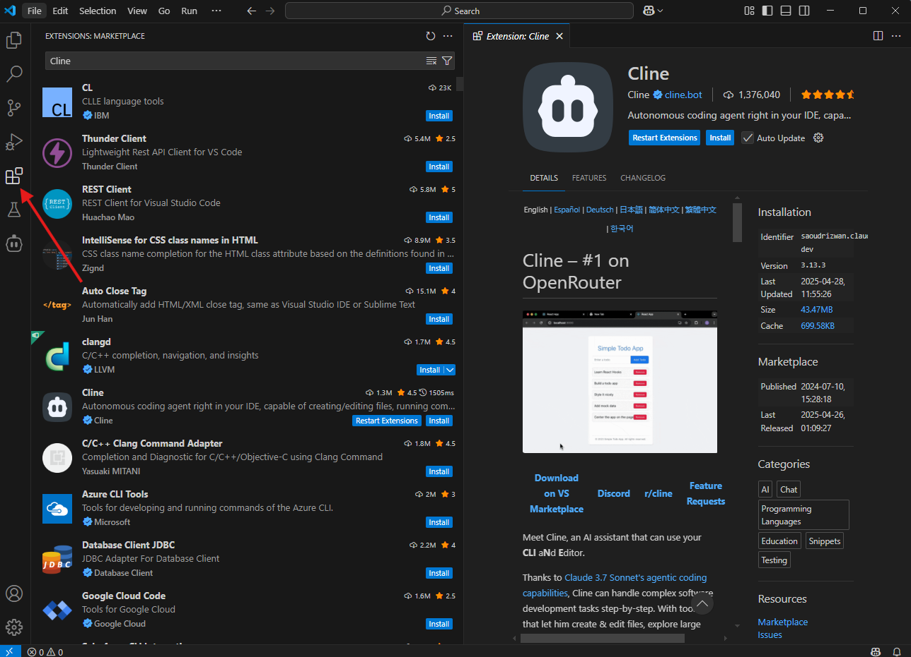
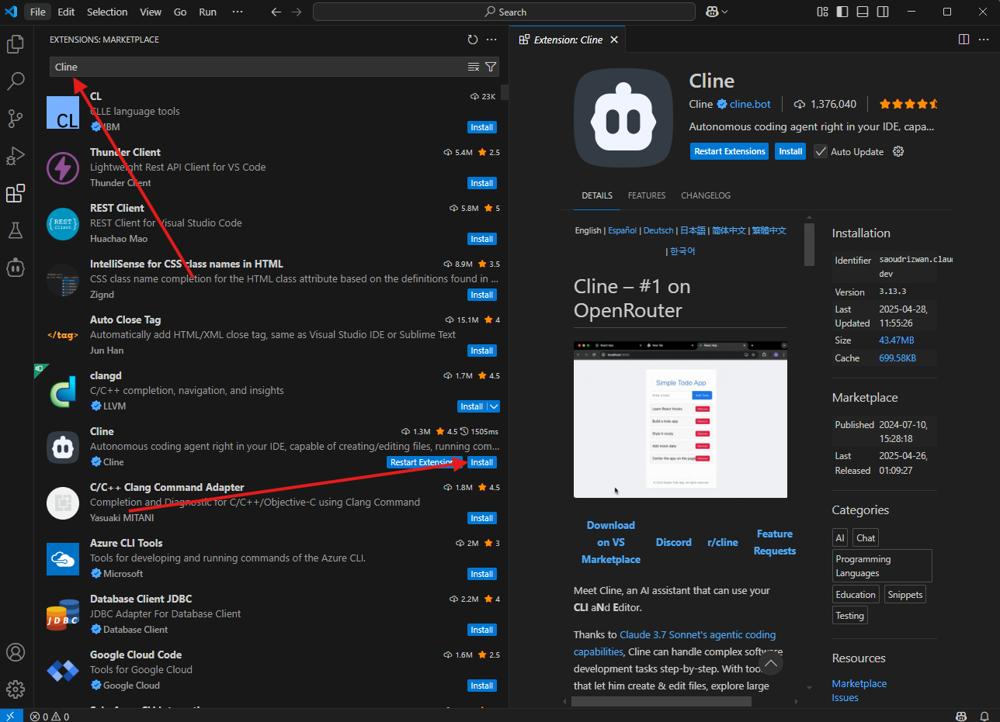
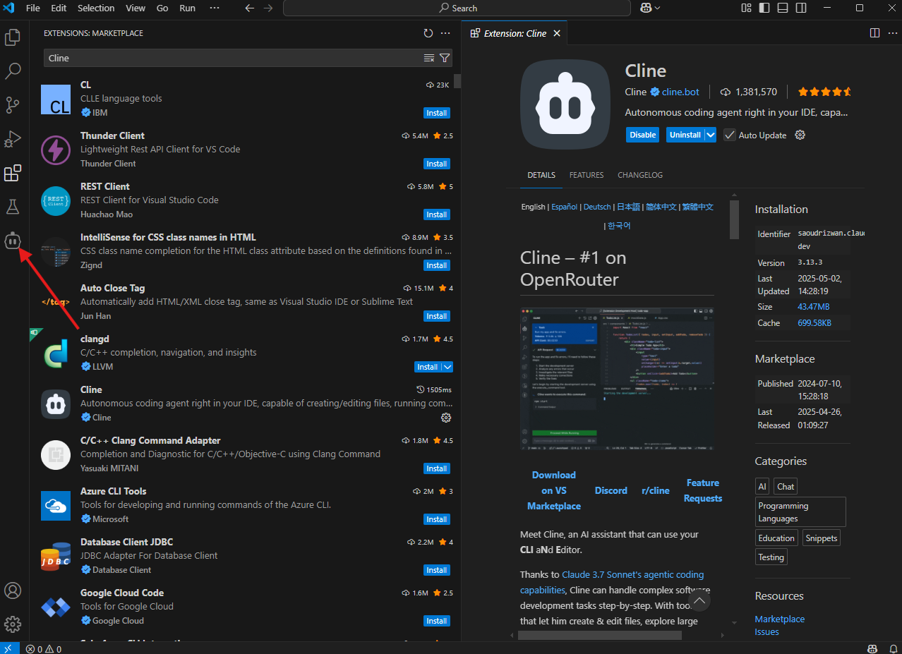
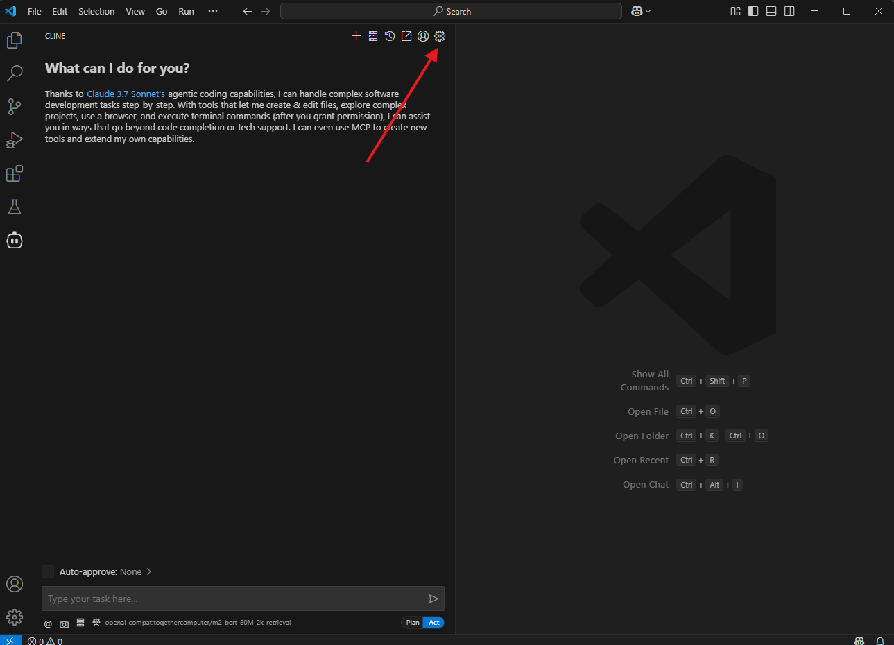
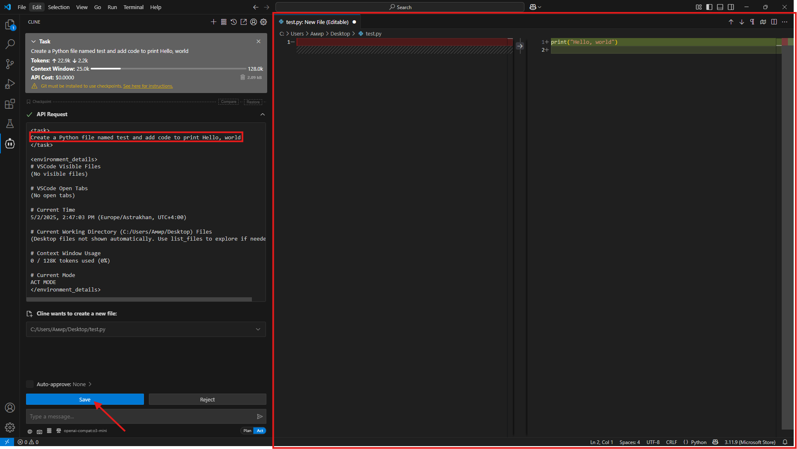
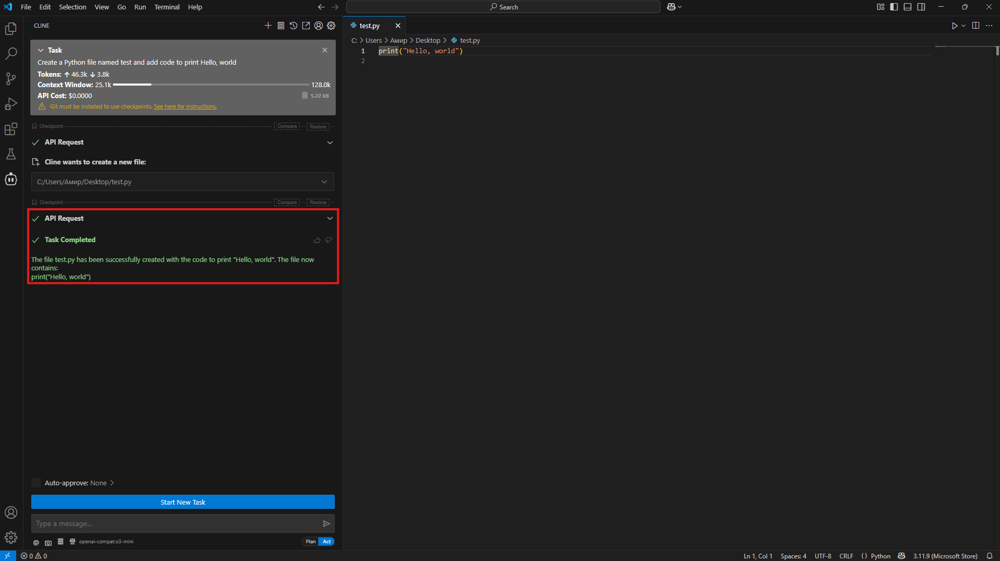

# Cline

## About

Cline is an open-source AI coding assistant with two working modes (Plan/Act), terminal command execution, and support for the Model Context Protocol (MCP) in VS Code.

You can find the Cline repository and community on [GitHub](https://github.com/cline).


Faster: run `npx aimlapi cline`. It signs you in through the browser and makes AI/ML API Cline's default provider, in both the CLI and the VS Code extension. It replaces an OpenAI Compatible provider you set up by hand; `aimlapi cline --undo` restores it. If you agree, it also connects the AI/ML API MCP server in `cline_mcp_settings.json` and installs four skills. See [CLI](../quickstart/cli.md#cline).


## Installing Cline in VS Code

1. Open the **Extensions** tab in the VS Code sidebar.

<figure><figcaption></figcaption></figure>

2. In the search bar, type **Cline**.
3. Find the extension and click **Install**.

<figure><figcaption></figcaption></figure>

4. After installation, a separate **Cline** tab will appear in the sidebar.

<figure><figcaption></figcaption></figure>

## **Configuring Cline**

1. Go to the **Cline** tab in the sidebar.
2. Click the gear icon in the top-right corner.

<figure><figcaption></figcaption></figure>

In the settings, pick one of the two options below.

### Option 1: AI/ML API provider (Cline v4.1.24 and later)

Cline ships **AI/ML API** (provider ID `aimlapi`) in its provider list, generated from the [models.dev](models-dev.md) catalog.

* In **API Provider**, search for **AI/ML API** and select it.
* In **Base URL**, make sure the value is `https://api.aimlapi.com/v1`. Enter it if the field is empty.
* In the API key field, enter your [AI/ML API key](https://aimlapi.com/app/keys).
* In **Model ID**, enter an AI/ML API model ID, for example `anthropic/claude-sonnet-5`.
* Click **Save**.

Cline uses the same OpenAI-compatible settings form for this provider, so the API key field may be labeled **OpenAI Compatible API Key**.

### Option 2: OpenAI Compatible provider

Use this on Cline versions before v4.1.24:

* Set **API Provider** to **OpenAI Compatible**.
* In **Base URL**, enter `https://api.aimlapi.com/v1`.
* In **API Key**, enter your [AI/ML API key](https://aimlapi.com/app/keys).
* In **Model ID**, specify the model name. You can find some model selection tips in our [description of code generation as a capability](../capabilities/code-generation.md).
* Click **Save**.

All done, start coding with Cline!

## Usage Example

Here’s the request we made:

```
Create a Python file named test and add code to print Hello, world
```

<figure><figcaption></figcaption></figure>

If you expand the **API Request** section, you can view the data — including your prompt.

Since I asked to create a file in the request, the file was generated. You can see a preview and its contents, but it hasn’t been saved yet.

To save the file, Cline asks for confirmation.

<figure><figcaption></figcaption></figure>

Once the file is saved, a second API request appears with metadata, along with a notification that the task was successfully completed.

## Model selection

Use exact AI/ML API chat model IDs, for example:

* `anthropic/claude-sonnet-5`: strong for coding
* `openai/gpt-5-5`: strong general use
* `google/gemini-3.6-flash`: lower latency and lower cost

With the AI/ML API provider, Cline suggests models from its copy of the models.dev catalog, which it refreshes at runtime. For the full catalog, use [All Model IDs](../api-references/model-database.md).

## Troubleshooting

Possible Issues:

* **403 status code (no body)** — This is the most common error. Possible causes:
  * The Base URL is not `https://api.aimlapi.com/v1`.
  * The user may have run out of tokens or doesn’t have enough. Check your balance in your account dashboard.
* **400 status code (no body)**: this error usually means the model ID is wrong or the model is not a chat model. Check the ID in [Model selection](cline.md#model-selection).
